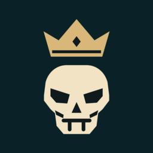

# Corsair King

초대 코드로 친구들과 즐기는 2–7인 카드게임. 현재 공개 테스트 버전입니다.

| 플랫폼 | 버전 | 설치 |
| --- | --- | --- |
| Android | **0.1.0 (32)** | [**Download APK**](https://github.com/HahnGyuTak/SkullKing-downloads/releases/download/v0.1.0-build32/corsair-king-0.1.0-32-preview-20261028-r2.apk) |
| iPhone | **0.1.0 (31)** | [**Join TestFlight**](https://testflight.apple.com/join/JmGv7aXB) |

[릴리스 · 변경 사항 · 파일 검증](https://github.com/HahnGyuTak/SkullKing-downloads/releases/latest)

## 설치

Android에서는 Download APK로 내려받은 파일을 열어 설치합니다. 기존 앱이 있으면 삭제하지 말고 업데이트로 설치하세요. 필요하면 파일을 연 브라우저 또는 파일 앱의 설치 권한을 허용합니다. Android 7.0 이상이며 64비트 ARM 또는 x86 기기가 필요합니다.

iPhone에서는 Apple의 TestFlight 앱을 설치한 뒤 Join TestFlight 링크로 참여합니다. 사전 기기 등록은 필요하지 않습니다. 31번부터 앱 이름이 Corsair King으로 표시됩니다.

## 새 이름

앱 이름은 **Corsair King**입니다. 31번부터 카드 표시도 **Davy Jones(데비 존스), Siren(세이렌), Hafgufa(하프구바), MobyDick(모비딕), Surrender(항복), Stowaway(밀항자)**로 바뀝니다. 기존 카드 그림·게임 규칙·앱ID와 저장 데이터는 유지합니다. Android 31과 iOS 31은 같은 서버에서 함께 플레이할 수 있습니다.

## 친구와 플레이

Create Room으로 방을 만들고 초대 코드를 공유하세요. 친구는 Join Room에서 코드를 입력하거나 카메라 버튼으로 대기방 바코드를 읽습니다. 2–7명이 모두 Ready하면 시작합니다. 방장은 Add Bot으로 빈자리를 채울 수 있어 혼자 접속해도 Bot과 시작할 수 있습니다.

30번부터 2인 게임은 두 자리로 진행합니다. 카드 뒷면을 1초 보여준 뒤 한 장당 260ms로 순서대로 공개하고 첫 카드 공개와 함께 Bidding이 시작됩니다. 트릭 결과는 타이머 자리에 3초 표시하고 라운드 사이에는 5초 기다립니다.

게임은 **Oracle Cloud 오사카 서버**에서 운영하며 인터넷이 필요합니다. Android32는 별도 서버 설정 없이 직접 Oracle로 연결합니다. 기존31번 위에 업데이트 설치하면 저장 계정을 유지합니다. 앱을 삭제하지 마세요. iOS32는 Apple 업로드·공개 절차를 진행 중이며, 현재 TestFlight 공개 버전은31번입니다.31번도 호환 연결을 통해 같은 Oracle 방에서 플레이할 수 있습니다. 정식 스토어 출시용1.0.0(33)은 별도로 준비 중입니다.

[개인정보처리방침](https://corsair-king.pages.dev/privacy/) · [지원](https://corsair-king.pages.dev/support/) · [계정 삭제](https://corsair-king.pages.dev/delete/)

이 저장소에는 배포 파일과 설치 안내만 공개합니다. 앱·서버 소스는 별도 비공개 저장소에서 관리합니다. 과거 버전의 내용은 Releases에 보존됩니다.
